  

  

    
    
    
  

---

  

- 🎓 **Diploma in Computer Science** student at Kolej Profesional MARA Beranang
- 🚀 **Microsoft Learn Student Ambassador** (`studentamb_682705`) & Google Gemini Certified Educator
- 💻 Full-Stack & Mobile Developer focusing on **Flutter, Node.js, Python, and AI integrations**
- 📍 Based in Federal Territory of Kuala Lumpur, Malaysia

---

  

  

---

  

### 🌟 Featured Projects
| Project | Description | Tech Stack |
| :--- | :--- | :--- |
| **[7NVENT (InvenTrack)](https://github.com/SyukriZ)** | 3-tier hotel inventory management & billing system (Web & Mobile) | Flutter, Node.js, Express, MySQL, Redis |
| **[Emotion Detection App](https://github.com/SyukriZ/emotion-detection-application)** | AI-powered text emotion analyzer web application | Python, Flask, IBM Watson NLP |
| **Business AI Meeting Companion** | Automated meeting insights & follow-up management system | Google Gemini API, Firebase Realtime DB |

---

  <h3>📊 GitHub Statistics</h3>
  
  

 

  

