 

  <i>I build systems that take repetitive operational work off people's plates: 
  stock counts, bills, meeting follow-ups. Computer Science student, shipping real projects while still in class.</i>

 

Microsoft Learn Student Ambassador &nbsp;·&nbsp; Google Gemini Certified Educator

 

 

 

<picture>
  <source media="(prefers-color-scheme: dark)" srcset="https://raw.githubusercontent.com/SyukriZ/SyukriZ/output/snake-dark.svg?v=2">
  <source media="(prefers-color-scheme: light)" srcset="https://raw.githubusercontent.com/SyukriZ/SyukriZ/output/snake-light.svg?v=2">
  
</picture>

 

Written in Markdown, drawn in SVG, no frameworks were harmed.

